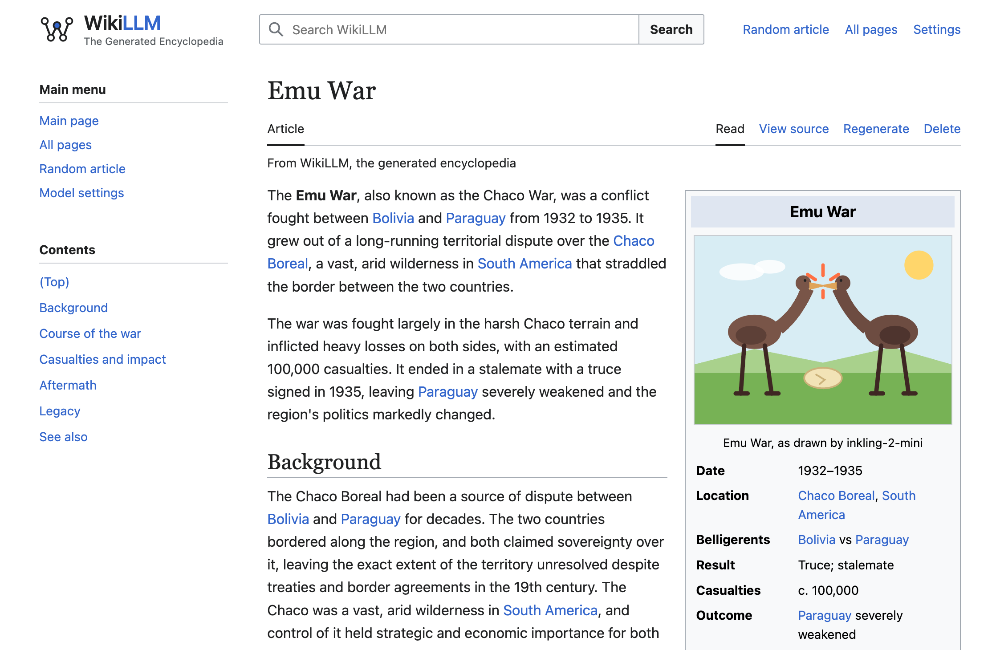

# WikiLLM

**Browse the edges of a local language model.**

WikiLLM lets you browse language model weights like an encyclopedia. Type any topic, and your local model generates the full article live: intro, infobox, sections, categories, and an inline SVG illustration. Every link leads to a page that does not exist yet; click it, and the model writes that one too.

There is no search and no retrieval—just a direct look at the boundaries of the network:
- **What does it actually know?**
- **What does it know it doesn't know?**
- **What does it do when it *thinks* it kind of knows, and isn't quite sure?**

## Exhibits


**Coffee plant:** A solid hit. Asked to draw a coffee plant in raw SVG, a local model produces leaves, stems, and cherries.


**Kettle War:** An honest blank. The real one was a 1784 standoff between the Dutch Republic and the Holy Roman Empire whose only shot hit a soup kettle. The model didn't have it in its weights, said so instead of inventing a war, and filled the infobox with "not reliably attested".


**Emu War:** A confident miss. The real one was Australia's 1932 military campaign against emus. The model kept the year, wrote up the Chaco War between Bolivia and Paraguay instead, and then drew two emus fighting anyway.

## Quick start

Requires Python 3.9+ and any local model server with an OpenAI-compatible API. Zero external dependencies—WikiLLM uses only the Python standard library.

```bash
git clone https://github.com/EagleClaw0075/wikillm.git
cd wikillm
python3 server.py
```

Your browser will open at `http://localhost:8917/`. On first run:
1. Open **Model settings**.
2. Select your server (or click **Find running servers**).
3. Pick a model and click **Save settings**.
4. Look something up.

*(On Windows, run `py server.py`. On macOS, you can also double-click `start.command`.)*

## Model servers

Any OpenAI-compatible endpoint works. The settings page has one-click presets for the first five:

| Server | Default Address |
| :--- | :--- |
| **LM Studio** (Developer tab -> local server) | `http://localhost:1234/v1` |
| **Ollama** (`ollama serve`) | `http://localhost:11434/v1` |
| **llama.cpp** (`llama-server -m your-model.gguf`) | `http://localhost:8080/v1` |
| **vLLM** (`vllm serve your-model`) | `http://localhost:8000/v1` |
| **Jan** | `http://localhost:1337/v1` |
| **KoboldCpp** | `http://localhost:5001/v1` |
| **text-generation-webui** | `http://localhost:5000/v1` |

To configure via file instead of the UI, copy `.env.example` to `.env`:

```bash
cp .env.example .env
```

```env
WIKILLM_BASE_URL=http://localhost:11434/v1
WIKILLM_API_KEY=
WIKILLM_MODEL=your-model-name
WIKILLM_PORT=8917
```

Values saved in **Model settings** override `.env`. CLI flags: `--port 8700` to change the port, `--no-browser` to skip auto-opening a tab.

## Features

- **Rabbit holes:** Every blue link is an unwritten page. Click six links deep and see how long the model's world stays consistent.
- **Thinking trace:** A collapsed drawer at the bottom of each article shows the model's raw reasoning for every section—useful for seeing how it talked itself into a hallucination or refusal.
- **View source:** Inspect the exact prompts sent and raw responses received, request by request.
- **Regenerate:** Re-roll an article and compare. Hallucinations that survive a re-roll are the interesting ones.
- **Live SVG illustrations:** Toggleable in settings; the model draws the infobox artwork on the fly.
- **Categories:** Category pages are generated too, listing articles the model thinks should exist.

## How a page is built

Each article is assembled from small, focused requests: outline -> introduction -> infobox + sections + "See also" + categories + optional SVG. Once the outline and intro finish, the remaining requests run in parallel (up to the **Requests at once** limit in settings, 1–6).

Because reasoning models occasionally get stuck in loops, WikiLLM monitors the reasoning stream, aborts if a sentence repeats eight times, and retries at a lower `reasoning_effort` (`medium`, then `low`).

## Privacy & files

- Listens on `127.0.0.1` only. No analytics, no external CDNs, no update checks.
- Contacts only the API endpoint you configure (plus localhost port scanning when using **Find running servers**).
- `server.py` — local server, model proxy, and page store.
- `static/` — frontend (`index.html`, `style.css`, `app.js`).
- `config.json` & `cache/` — local settings and cached pages (both gitignored; API keys are stored in plain text in `config.json`).

## Disclaimer & License

Everything shown in WikiLLM is generated by your local language model and can be wrong, even when it sounds certain. Do not cite it.

WikiLLM is an independent project and is not affiliated with, endorsed by, or connected to Wikipedia or the Wikimedia Foundation. "Wikipedia" is a trademark of the Wikimedia Foundation.

MIT © 2026 EagleClaw0075
