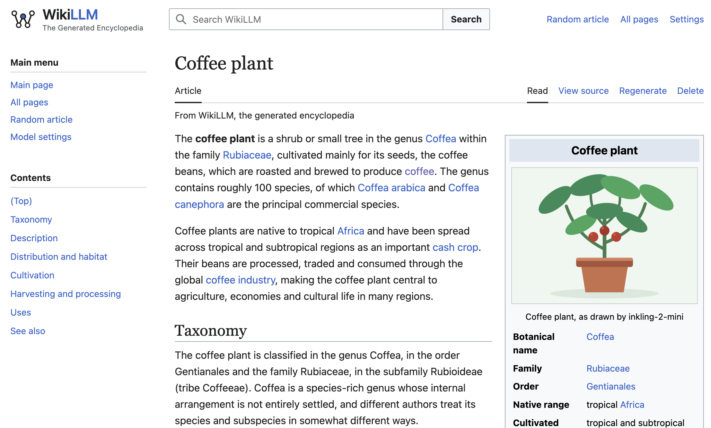
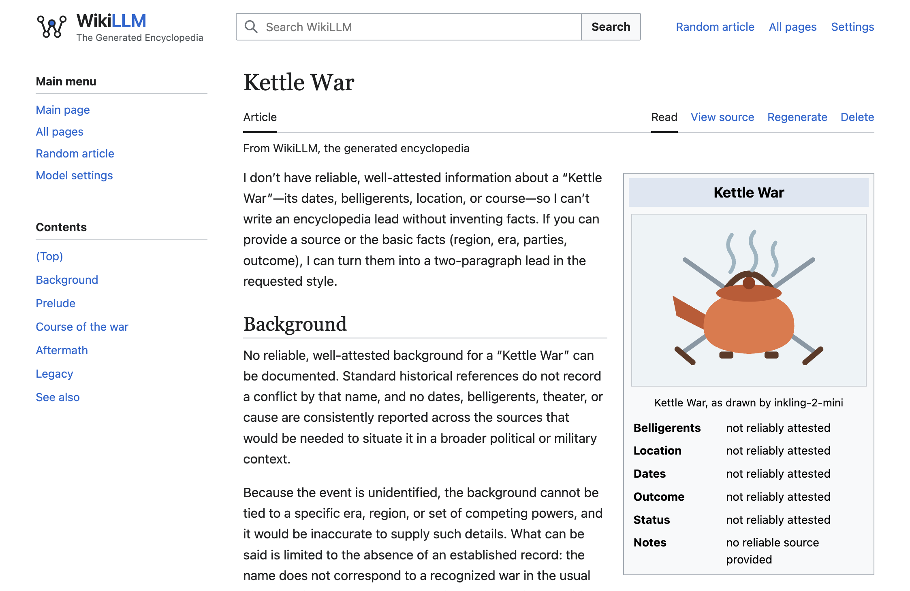

# WikiLLM

**Browse the edges of a local language model.**

WikiLLM lets you explore what is actually inside those weights like an encyclopedia. Type any topic, and your local model generates the full article live: intro, infobox, sections, categories, and an inline SVG illustration. Every link leads to a page that does not exist yet; click it, and the model writes that one too.

There is no search and no retrieval—just a direct look at the boundaries of the network:
- **What does it actually know?**
- **What does it know it doesn't know?**
- **What does it do when it *thinks* it kind of knows, and isn't quite sure?**

## Exhibits


**Coffee plant:** A solid hit. Asked to draw a coffee plant in raw SVG, a local model produces leaves, stems, and cherries.


**Kettle War:** An honest blank. The real one was a 1784 standoff between the Dutch Republic and the Holy Roman Empire whose only shot hit a soup kettle. The model didn't have it in its weights, said so instead of inventing a war, and filled the infobox with "not reliably attested".


**Emu War:** A confident miss. The real one was Australia's 1932 military campaign against emus. The model kept the year, wrote up the Chaco War between Bolivia and Paraguay instead, and then drew two emus fighting anyway.

## Quick start

Requires Python 3.9+ and any local model server with an OpenAI-compatible API. Zero external dependencies—WikiLLM uses only the Python standard library.

```bash
git clone https://github.com/EagleClaw0075/wikillm.git
cd wikillm
python3 server.py
```
